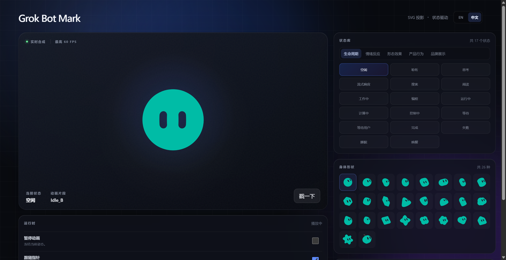

# Avatar Grok Design

[English](README.md) | [简体中文](README.zh-CN.md)

An interactive motion study for the Grok Bot mark, built with React, TypeScript,
and Vite.

The project provides live state controls, 26 body shapes, preset and custom ink
colors, animation playback settings, pointer-following behavior, and a
standalone Mark rendering engine.

## Screenshots



## Distribution notice

This repository includes third-party-derived animation code. It is **not
covered by an open-source license in this repository**. Do not publish or
redistribute that code publicly until you have confirmed the applicable rights
and authorization. This repository does not grant a license for it.

## Features

- 53 animation states grouped by lifecycle, reactions, morphs, product, and brand
- 26 procedural body shapes
- 11 preset ink colors plus a custom color picker
- State-aware clips, facial presets, morphs, and bridge transitions
- Pointer-following gaze, blinking, squash, bob, spin, and poke effects
- Idle settling, reduced-motion support, and 30/60 FPS limits
- Responsive, bilingual English and Chinese control interface

## Requirements

- Node.js `^20.19.0` or `>=22.12.0`
- npm 10 or newer

## Run locally

```bash
npm install
npm run dev
```

Vite starts the development server at `http://127.0.0.1:4173`.

## Verify and build

```bash
npm run check
npm test
npm run build
```

The production output is written to `dist/`, which is excluded from Git.

## Project structure

```text
src/
├─ avatar/
│  ├─ types.ts               shapes, colors, states, and frame types
│  ├─ stateModel.ts          agent facts to symbolic mark state
│  ├─ animationClips.ts      clip profiles and state definitions
│  ├─ shapeGeometry.ts       procedural shape paths and metrics
│  ├─ motionEngine.ts        simplified behavioral motion renderer
│  ├─ markEngine.ts          typed adapter for the standalone engine
│  ├─ MarkCanvas.tsx         React lifecycle and browser attachment
│  ├─ reconstruction/        motion primitives used by the fallback renderer
│  └─ GrokBotMark.tsx        fallback UI and behavioral renderer
├─ engine/grok-bot-mark/     standalone Mark engine runtime
├─ App.tsx                   interactive control surface
├─ i18n.ts                   English and Chinese interface copy
└─ styles.css                responsive layout and visual styling
```

## Component usage

```tsx
import { GrokBotMark } from "./avatar";

<GrokBotMark
  color="blue"
  shape="blob"
  state="working"
  size={240}
  followPointer
/>;
```

Imperative controls are available through a ref:

```tsx
const mark = useRef<GrokBotMarkHandle>(null);

mark.current?.poke("bounce");
mark.current?.poke("spin", 2);
```

## State derivation

```ts
const state = deriveMarkState(agentFacts, Date.now(), surfaceFacts);
```

The derivation follows the observed client behavior:

1. Running or composing agents use `streaming` or the current activity mapping.
2. `awaitingUserResponse` maps to `blocked`.
3. A recent successful or failed turn remains visible for eight seconds.
4. Roster facts take precedence over surface facts.
5. Otherwise, the mark returns to `idle`.

## Engine architecture

The state scheduler, clip sampler, facial state machine, morph springs, gaze
smoothing, and SVG projection are documented in
[`docs/mark-engine.zh-CN.md`](docs/mark-engine.zh-CN.md).
