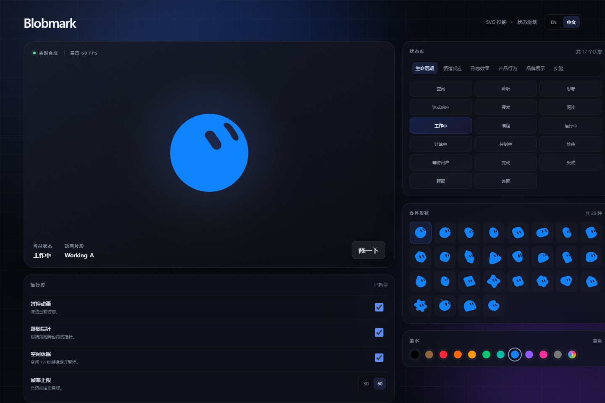

# Blobmark

[English](README.md) | [简体中文](README.zh-CN.md)

Blobmark 是一个从 Grok Bot 标志动作研究中诞生的动态代理标志，同时也是 npm 库。
包内直接提供现成的形象预设、外观配置和行为动作，别的项目只要安装并引入这个包，
就能渲染出完整的动态标志。

仓库本身还包含用于设计和检查每种形状、颜色与状态的交互控制界面。

## 截图



## 功能

- 59 种动画状态，分为生命周期、情绪反应、形态效果、产品行为、品牌展示和实验
- 28 种程序化身体形状
- 实验：幽灵/饼干两个身体，打喷嚏/发抖/伸懒腰/打盹/踱步/眨眼六个行为
- 11 种预设墨水颜色及自定义十六进制颜色
- 10 套命名形象预设，组合形状、墨水颜色与入场状态
- 14 个行为动作，带时序、可串联，并会自动回到起始状态
- 同时提供 React 组件、React Hook 以及无需 React 的 DOM 挂载控制器
- 状态动画片段、面部预设、形态效果和桥接过渡
- 指针跟随视线、眨眼、挤压、上下浮动、旋转及戳动效果
- 空闲稳定、减少动态效果支持及 30/60 FPS 上限
- ESM + CJS 双格式构建、严格类型声明和随包发布的样式表
- 支持响应式布局的中英文演示界面

## 环境要求

- Node.js `^20.19.0` 或 `>=22.12.0`（测试运行器要求 `>=22.12.0`）
- npm 10 或更高版本
- React `>=18.3`（peer 依赖，仅 React 入口需要）

## 安装这个包

和普通依赖一样使用，三种安装方式任选：

```bash
# 从本地仓库安装
npm install ../blobmark

# 从打包好的 tarball 安装（无需访问 registry）
npm pack                # 生成 blobmark-0.2.0.tgz
npm install ./blobmark-0.2.0.tgz

# 发布到 registry 之后
npm install blobmark
```

样式表随包发布，需要在应用里引入一次：

```ts
import "blobmark/style.css";
```

### React 用法

```tsx
import {
  GrokBotMark,
  createAvatarConfig,
  useGrokBotAvatar,
  type AgentFacts,
} from "blobmark";
import "blobmark/style.css";

export function AgentAvatar({ facts }: { facts: AgentFacts }) {
  const avatar = useGrokBotAvatar({ preset: "mint", size: 160, facts });

  return (
    <div>
      <GrokBotMark {...avatar.props} ref={avatar.ref} />
      <button onClick={() => avatar.play("celebrate")}>庆祝</button>
      <button onClick={() => avatar.poke("bounce")}>戳一下</button>
      <button onClick={() => avatar.setState("thinking")}>思考</button>
    </div>
  );
}
```

不使用 Hook 时，组件可以完全受控：

```tsx
import { GrokBotMark, createAvatarConfig } from "blobmark";

const config = createAvatarConfig({ preset: "ghost", size: 96 });

<GrokBotMark {...config} state="listening" followPointer />;
```

通过 `ref` 可以调用底层动作：

```tsx
const mark = useRef<GrokBotMarkHandle>(null);

mark.current?.poke("bounce");
mark.current?.poke("spin", 2);
mark.current?.restart();
```

### 现成的形象预设与配置

预设是纯数据，可直接用于画廊、选择器等界面。每套预设包含身体形状、墨水颜色和
入场状态。

```ts
import {
  AVATAR_PRESETS,
  createAvatarConfig,
  listAvatarPresets,
  type AvatarConfig,
} from "blobmark";

const presetIds = Object.keys(AVATAR_PRESETS);
// classic、midnight、ember、mint、neon、ghost、cookie、starlight、sunset、brand

const config: AvatarConfig = createAvatarConfig({
  preset: "sunset", // 形状 + 颜色 + 自定义色值 + 初始状态
  size: 180, // 显式传入的值优先于预设
  followPointer: true,
});

// config 的每个键都与组件属性一一对应：
<GrokBotMark {...config} />;
```

可配置项：`state`、`shape`、`color`、`colorHex`、`size`、`paused`、
`followPointer`、`settleIdle`、`maxFrameRate`（`30 | 60`）、`reducedMotion`。

### 行为动作

行为动作是一串带时序的动作状态。执行器会在当前静止状态之上播放动作，结束后回到
动作开始前的状态，因此代理驱动的状态不会丢失。

```ts
import { AVATAR_ACTIONS, actionDurationMs, resolveAvatarAction } from "blobmark";

// greet、nod、celebrate、spin、think、search、code、success、failure、
// sleep、wake、alert、dance、listen
const action = resolveAvatarAction("success");
actionDurationMs(action); // 总播放时长（毫秒）

const avatar = useGrokBotAvatar({ preset: "classic" });
avatar.play("success"); // 播放 finished → happy → idle
avatar.stop(); // 取消并回到静止状态
```

非 React 环境可以直接使用同一个调度器：

```ts
import { createAvatarActionRunner } from "blobmark/vanilla";

const runner = createAvatarActionRunner({
  getBaseState: () => mark.config.state,
  setState: (state) => mark.setState(state),
  onEffect: (kind) => mark.poke(kind),
});

runner.play("celebrate");
```

### 由代理事实推导状态

把 `AgentFacts` 传给 Hook（或自行调用 `deriveMarkState`），标志就会跟随代理生命周期
自动切换状态。推导出的状态优先于 `state` 选项；行为动作会暂时覆盖两者，结束后回到
推导出的状态。

```ts
import { deriveMarkState } from "blobmark";

const state = deriveMarkState(agentFacts, Date.now(), surfaceFacts);
```

### 无 React / 其他框架

`./vanilla` 入口不依赖 React，可以把标志挂载到任意元素上，适用于 Vue、Svelte、
Angular、原生 HTML 或浏览器扩展。

```ts
import { mountGrokBotMark } from "blobmark/vanilla";
import "blobmark/style.css";

const mark = mountGrokBotMark("#stage", {
  preset: "ember",
  size: 200,
  followPointer: true,
});

mark.play("dance");
mark.setState("working");
mark.setShape("star");
mark.setColor("violet");
mark.poke("spin");
mark.destroy();
```

vanilla 控制器会自动检测系统的“减少动态效果”设置，可用 `reducedMotion: false` 覆盖。

### 底层引擎

两个入口都导出了运行时原语，便于自定义渲染或非 DOM 环境使用：

```ts
import {
  canonicalBody,
  createAppearance,
  createMarkEngine,
  getShapeGeometry,
  STATE_DEFINITIONS,
} from "blobmark/vanilla";
```

### 包的导出

| 引入路径                       | 内容                                                     |
| ------------------------------ | -------------------------------------------------------- |
| `blobmark`           | React 组件、Hook、预设、动作、目录数据和引擎原语         |
| `blobmark/vanilla`   | DOM 挂载、预设、动作、目录数据、引擎（不含 React）       |
| `blobmark/style.css` | 组件样式表                                               |

构建自定义界面所需的目录数据都以值的形式导出：`SHAPE_OPTIONS`（28）、
`COLOR_OPTIONS`（11 + 色值）、`MARK_STATE_GROUPS`（59）、`STATE_DEFINITIONS`、
`MOTION_CLIPS`、`ACTIVITY_TO_STATE` 和 `listMarkStates()`。

### 服务端渲染

`GrokBotMark` 只在浏览器里运行真实引擎；服务端渲染时会输出带尺寸的宿主元素，在
客户端水合后开始绘制。如果需要服务端直接输出完整 SVG，请使用
`SvgGrokBotMark`（行为回退渲染器），它在服务端就能生成完整的 SVG 标记。

在 React Server Component 框架里，请把 `GrokBotMark` 放在客户端组件中使用；预设、
动作、目录数据和 `deriveMarkState` 等纯数据导出不依赖浏览器，可以在服务端直接使用。

## 本地运行演示

```bash
npm install
npm run dev
```

Vite 会在 `http://127.0.0.1:4173` 启动演示界面。

## 脚本

| 命令                     | 作用                                                     |
| ------------------------ | -------------------------------------------------------- |
| `npm run dev`            | 启动演示开发服务器                                       |
| `npm run build`          | 类型检查后把库构建到 `dist/`                             |
| `npm run build:lib`      | 仅构建库（Vite 入口、类型声明、静态资源）                |
| `npm run build:demo`     | 把演示界面构建到 `demo-dist/`                            |
| `npm run check`          | `tsc --noEmit`                                           |
| `npm test`               | Vitest 测试套件                                          |
| `npm run preview`        | 预览构建后的演示界面                                     |
| `npm run verify:package` | 打包、安装到临时消费项目，校验 ESM/CJS/类型/样式         |

`npm run verify:package` 是端到端校验：它会打出 tarball，安装到
`.package-check/consumer/node_modules`，服务端渲染 React 组件、`require` CJS 入口、
引入无 React 的入口，并用严格的 `nodenext` 配置对发布出来的类型声明做类型检查。

## 包的目录结构

```text
dist/
├─ index.js / index.cjs        React 入口
├─ vanilla.js / vanilla.cjs    无 React 入口
├─ avatar.css                  组件样式表（blobmark/style.css）
└─ types/                      两个入口的类型声明
```

独立引擎会被打进共享 chunk，由两个入口共同引用。

## 项目结构

```text
src/
├─ index.ts                   React 包入口
├─ vanilla.ts                 无 React 包入口
├─ avatar/
│  ├─ index.ts                公共 API 汇总
│  ├─ types.ts                形状、颜色、状态和帧类型
│  ├─ presets.ts              命名形象预设与解析后的配置
│  ├─ actions.ts              行为动作目录与执行器
│  ├─ useGrokBotAvatar.ts     状态、预设、动作的 React Hook
│  ├─ vanilla.ts              无 React 的 DOM 挂载控制器
│  ├─ avatar.css              组件样式表
│  ├─ stateModel.ts           代理事实到符号化标志状态的推导
│  ├─ animationClips.ts       动画片段配置与状态定义
│  ├─ shapeGeometry.ts        程序化形状路径与尺寸参数
│  ├─ motionEngine.ts         简化行为渲染器的运动核心
│  ├─ markEngine.ts           独立引擎的类型化适配层
│  ├─ MarkCanvas.tsx          React 生命周期与浏览器绑定
│  ├─ reconstruction/         备用渲染器使用的动作原语
│  ├─ lab/                    新形象、引擎数据说明与测试
│  └─ GrokBotMark.tsx         备用界面与行为渲染器
├─ engine/                    独立 Mark 引擎运行时与类型
├─ App.tsx                    交互式演示控制界面
├─ i18n.ts                    中英文演示文案
└─ styles.css                 演示布局，内部引入 avatar.css

scripts/
├─ build-assets.mjs           把引擎类型与样式表复制进 dist
└─ verify-package.mjs         端到端的包校验
```

## 状态推导

```ts
const state = deriveMarkState(agentFacts, Date.now(), surfaceFacts);
```

推导逻辑：

1. 正在运行或正在编写消息的代理使用 `streaming` 或当前活动对应的状态。
2. `awaitingUserResponse` 映射为 `blocked`。
3. 最近一次成功或失败回合的结果会继续显示 8 秒。
4. 代理列表事实优先于界面表面事实。
5. 其他情况下，标志返回 `idle` 状态。

## 引擎架构

状态调度、关键帧采样、面部状态机、morph spring、视线阻尼和 SVG 投影说明位于
[`docs/mark-engine.zh-CN.md`](docs/mark-engine.zh-CN.md)。

## 发布到 npm

包中故意保留了 `"private": true`，避免误发布。需要发布时：

1. 删除 `package.json` 中的 `"private"` 字段。
2. 按实际情况填写 `"license"`、`"repository"` 和 `"author"`。
3. 执行 `npm publish`（`prepublishOnly` 会先自动构建、测试并校验 tarball）。

在发布之前，用上文给出的本地路径或 tarball 方式安装即可。

