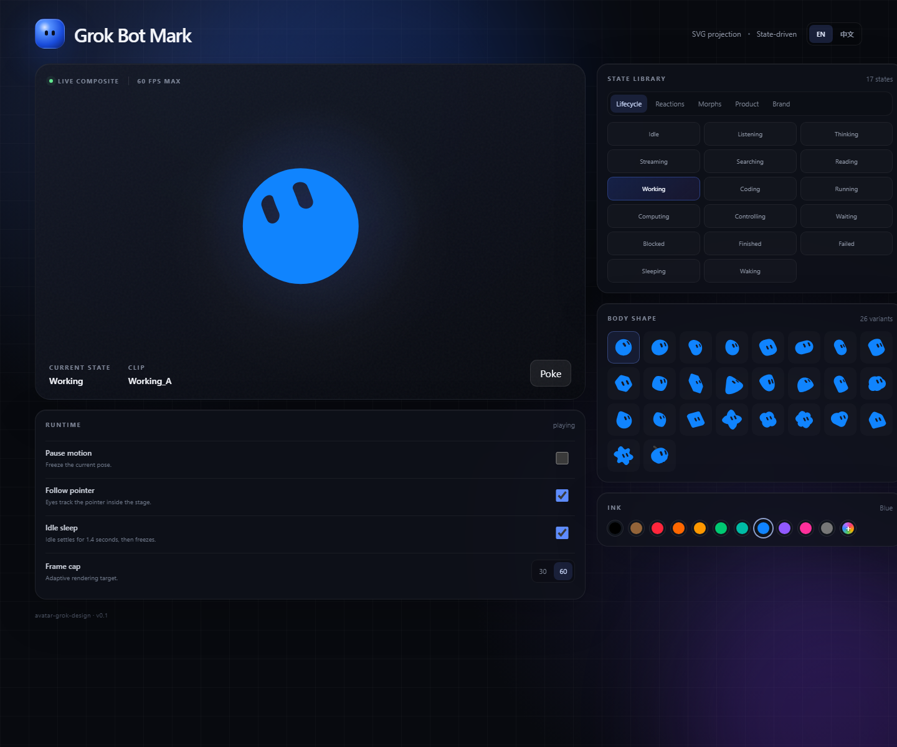

# Avatar Grok Design

[English](README.md) | [简体中文](README.zh-CN.md)

这是一个基于 React、TypeScript 和 Vite 构建的 Grok Bot 标志交互式动作研究项目。

项目提供实时状态控制、26 种身体形状、预设及自定义墨水颜色、动画播放设置和指针跟随行为，并包含一个独立的 Mark 渲染引擎。

## 截图



## 功能

- 53 种动画状态，分为生命周期、情绪反应、形态效果、产品行为和品牌展示
- 26 种程序化身体形状
- 11 种预设墨水颜色及自定义取色器
- 状态动画片段、面部预设、形态效果和桥接过渡
- 指针跟随视线、眨眼、挤压、上下浮动、旋转及戳动效果
- 空闲稳定、减少动态效果支持及 30/60 FPS 上限
- 支持响应式布局的中英文控制界面

## 环境要求

- Node.js `^20.19.0` 或 `>=22.12.0`
- npm 10 或更高版本

## 本地运行

```bash
npm install
npm run dev
```

Vite 会在 `http://127.0.0.1:4173` 启动开发服务器。

## 验证与构建

```bash
npm run check
npm test
npm run build
```

生产构建输出到 `dist/`，该目录已从 Git 中排除。

## 项目结构

```text
src/
├─ avatar/
│  ├─ types.ts               形状、颜色、状态和帧类型
│  ├─ stateModel.ts          代理事实到符号化标志状态的推导
│  ├─ animationClips.ts      动画片段配置与状态定义
│  ├─ shapeGeometry.ts       程序化形状路径与尺寸参数
│  ├─ motionEngine.ts        简化行为渲染器的运动核心
│  ├─ markEngine.ts          独立引擎的类型化适配层
│  ├─ MarkCanvas.tsx         React 生命周期与浏览器绑定
│  ├─ reconstruction/        备用渲染器使用的动作原语
│  └─ GrokBotMark.tsx        备用界面与行为渲染器
├─ engine/grok-bot-mark/     独立 Mark 引擎运行时
├─ App.tsx                   交互控制界面
├─ i18n.ts                   中英文界面文案
└─ styles.css                响应式布局与视觉样式
```

## 组件用法

```tsx
import { GrokBotMark } from "./avatar";

<GrokBotMark
  color="blue"
  shape="blob"
  state="working"
  size={240}
  followPointer
/>;
```

可以通过 `ref` 调用命令式控制方法：

```tsx
const mark = useRef<GrokBotMarkHandle>(null);

mark.current?.poke("bounce");
mark.current?.poke("spin", 2);
```

## 状态推导

```ts
const state = deriveMarkState(agentFacts, Date.now(), surfaceFacts);
```

推导逻辑：

1. 正在运行或正在编写消息的代理使用 `streaming` 或当前活动对应的状态。
2. `awaitingUserResponse` 映射为 `blocked`。
3. 最近一次成功或失败回合的结果会继续显示 8 秒。
4. 代理列表事实优先于界面表面事实。
5. 其他情况下，标志返回 `idle` 状态。

## 引擎架构

状态调度、关键帧采样、面部状态机、morph spring、视线阻尼和 SVG 投影说明位于
[`docs/mark-engine.zh-CN.md`](docs/mark-engine.zh-CN.md)。
